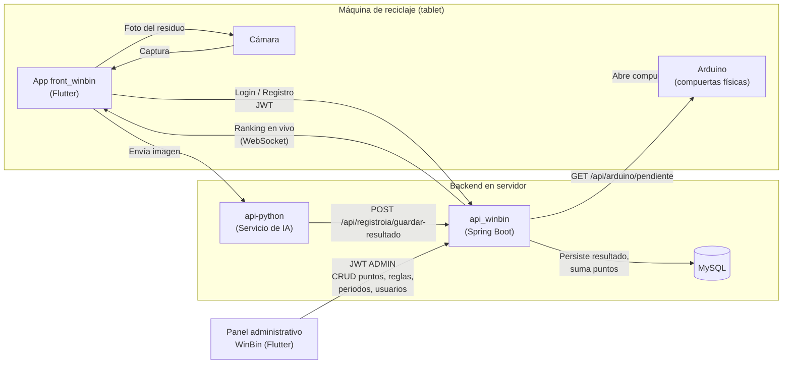
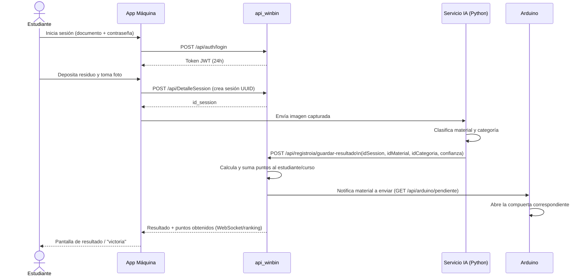
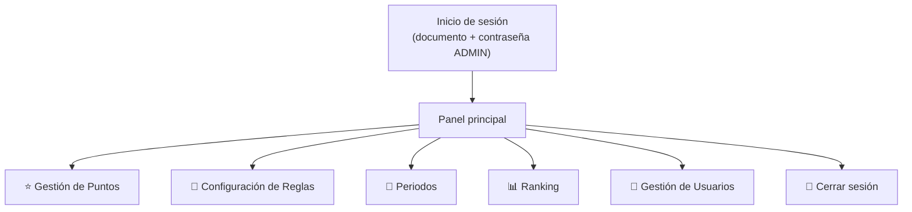

# 📘 Manual de Usuario — Ecosistema WinBin

## 1. Descripción general

**WinBin** es un ecosistema de reciclaje gamificado para instituciones educativas. Combina un
**punto de reciclaje físico (máquina/caneca inteligente)** con cámara y Arduino, un **servicio de
inteligencia artificial** que clasifica el material depositado, una **API central** que registra la
actividad y otorga puntos, y dos aplicaciones Flutter: una para que los **estudiantes** usen en la
máquina y otra de **panel administrativo** para docentes/administradores.

El objetivo pedagógico es que los estudiantes reciclen correctamente, acumulen puntos por curso y
compitan en un ranking por periodos académicos, mientras el colegio obtiene métricas de impacto
ambiental.

Este documento es el **manual de usuario funcional** del proyecto. Para instalación y despliegue
técnico vea [`MANUAL_INSTALACION.md`](./MANUAL_INSTALACION.md); para la referencia de endpoints vea
[`OPENAPI.md`](./OPENAPI.md); para resolución de incidentes en producción vea
[`RUNBOOK_INCIDENTES.md`](./RUNBOOK_INCIDENTES.md).

## 2. Componentes del ecosistema

| Repositorio | Tecnología | Rol | Quién lo usa |
|---|---|---|---|
| `api_winbin` | Spring Boot (Java) + MySQL | API central: autenticación, usuarios, puntos, ranking, periodos, auditoría, puente con Arduino | Todos los clientes (apps y servicio de IA) |
| `frontend_winbin_maquina` | Flutter (`front_winbin`) | App instalada en la tablet/pantalla de la **máquina de reciclaje**. Login/registro de estudiantes, cámara de escaneo, ranking en vivo | Estudiantes, frente a la máquina física |
| `WinBin` (Flutter `winbin`) | Flutter | **Panel administrativo**: gestión de puntos, reglas, periodos, ranking y usuarios | Docentes / administradores del colegio |
| *(externo)* `api-python` | Python | Servicio de IA que clasifica la foto del residuo y reporta el resultado a `api_winbin` | Automático, invocado por la máquina |
| *(hardware)* Arduino | Firmware | Abre la compuerta/recipiente correspondiente al material clasificado | Automático, controlado por la API |

### 2.1 Arquitectura

### 2.2 Flujo completo de una clasificación (secuencia)

## 3. Roles de usuario

| Rol | Descripción | Qué puede hacer |
|---|---|---|
| **ESTUDIANTE** | Rol por defecto al registrarse | Iniciar sesión en la app de la máquina, reciclar, ver su perfil, puntos y el ranking |
| **ADMIN** | Docente o administrador del colegio | Todo lo anterior + panel administrativo completo (usuarios, puntos, reglas, periodos, auditoría) |
| **PUENTE** | Rol técnico de integración | Usado por servicios internos (p. ej. el servicio de IA) para reportar resultados sin ser un estudiante |

## 4. Manual de la App de la Máquina (`front_winbin`)

Esta es la aplicación que corre en la pantalla táctil junto al punto de reciclaje físico.

### 4.1 Pantalla de inicio
Muestra el título de bienvenida, el ranking en vivo (mejor estudiante y mejor curso) y dos botones:
- **INGRESAR** → abre el login.
- **CREAR UNA CUENTA** → abre el registro.

### 4.2 Registro de estudiante
1. Toca **CREAR UNA CUENTA**.
2. Completa documento, nombre, curso y contraseña.
3. Al guardar, el backend crea el usuario con rol `ESTUDIANTE` y `puntos = 0`.
4. Vuelve a la pantalla de inicio para iniciar sesión.

### 4.3 Inicio de sesión
1. Toca **INGRESAR**.
2. Ingresa **documento** y **contraseña**.
3. La app llama a `POST /api/auth/login`; si las credenciales son correctas recibe un token JWT
   válido por 24 horas y pasa a la pantalla de escaneo.
4. Errores comunes: cuenta desactivada (habla con un administrador) o credenciales incorrectas.

### 4.4 Escaneo y clasificación del residuo
1. En la pantalla **"WinBin - Escáner de Reciclaje"**, el estudiante enfoca la cámara hacia el
   material que va a desechar.
2. Al capturar la foto, la app crea una **sesión de clasificación** (`id_session`) y envía la
   imagen al servicio de IA.
3. El servicio de IA determina el **material** y la **categoría/tamaño** (pequeño, mediano,
   grande) y reporta el resultado a la API.
4. La API suma los puntos correspondientes al estudiante y a su curso, y envía la orden al
   **Arduino** para que abra la compuerta del contenedor correcto.
5. La app muestra el resultado (material detectado, puntos ganados) y actualiza el ranking en
   vivo.

> Si el resultado no coincide con el material real, un administrador puede corregirlo desde la
> API (`PATCH /api/registroia/{id}`).

## 5. Manual del Panel Administrativo (`WinBin`)

App de escritorio/web pensada para docentes y administradores. Tras iniciar sesión con un usuario
`ADMIN`, se accede al panel con un menú lateral de 5 módulos:

### 5.1 Gestión de Puntos
- Busca un estudiante por nombre o documento.
- La tabla de resultados muestra nombre, curso y puntos actuales.
- Botón **Editar Puntos** para ajustar manualmente el puntaje de un estudiante (casos de
  corrección o bonificaciones).

### 5.2 Configuración de Reglas
- Define los **materiales** reciclables (ej. cartón, plástico, vidrio, orgánico) y las
  **categorías de puntaje** asociadas a cada tamaño (pequeño, mediano, grande), es decir cuántos
  puntos otorga cada combinación material/tamaño.
- Aquí se mantiene la tabla que usa el servicio de IA y la API para calcular puntos
  automáticamente en cada escaneo.

### 5.3 Periodos
- Un **periodo de ranking** (`id_periodo`, formato `PER-YYYY-MM-XXXXXX`) define la ventana de
  tiempo (fecha inicio/fin) en la que se acumulan puntos para la competencia.
- Solo puede existir **un periodo activo** a la vez.
- Acciones disponibles: crear periodo, **cerrar periodo manualmente** (genera el historial de
  ganadores) y eliminar periodos.

### 5.4 Ranking
- Tabla de posiciones por estudiante o por curso, con filtros por **semana, mes, periodo o año**.
- Columnas: posición, estudiante/curso, kilogramos reciclados (equivalente) y puntos.
- Botón **Exportar a PDF / Excel** para reportes institucionales.

### 5.5 Gestión de Usuarios
- Lista de usuarios activos e inactivos.
- Permite cambiar el **rol** de un usuario (`ESTUDIANTE` ↔ `ADMIN`), **desactivar** (borrado
  lógico) y **reactivar** cuentas, y actualizar datos básicos (nombre, curso).

### 5.6 Cierre de sesión
Botón **Logout** en la parte inferior del menú; invalida la sesión local y vuelve al login.

## 6. Referencia rápida de la API

La API expone un índice automático de todos sus endpoints en `GET /api`. Resumen por módulo:

| Módulo | Ruta base | Público / Protegido |
|---|---|---|
| Autenticación | `/api/auth/login` | Público |
| Usuarios | `/api/usuarios/**` | JWT (algunas acciones requieren ADMIN) |
| Materiales | `/api/materiales` | JWT |
| Categoría de puntaje | `/api/CategoriaPuntaje` | JWT |
| Sesiones de clasificación | `/api/DetalleSession` | JWT |
| Registro de IA | `/api/registroia/**` | JWT (listar/editar: ADMIN) |
| Ranking | `/api/ranking/**` | JWT |
| Periodos de ranking | `/api/PeriodoRanking/**` | JWT (crear/cerrar: ADMIN) |
| Historial de ganadores | `/api/HistorialGanadores` | JWT |
| Cursos | `/api/cursos` | Listar es público; crear/editar ADMIN |
| Recursos multimedia | `/api/RecursosMultimedia` | JWT |
| Dashboard | `/api/dashboard/resumen-completo` | JWT |
| Auditoría | `/api/auditoria` | JWT |
| Puente Arduino | `/api/arduino/pendiente` | Interno (hardware) |

Para el detalle completo de cada endpoint, ejemplos de body y autenticación con JWT en Swagger,
ver [`OPENAPI.md`](./OPENAPI.md).

## 7. Preguntas frecuentes

**¿Qué hago si al reciclar la app no detecta el material correctamente?**
Un administrador puede corregir el registro desde `PATCH /api/registroia/{id}` o reasignando
puntos manualmente en el módulo **Gestión de Puntos**.

**¿Qué pasa si cierro un periodo por error?**
El cierre genera el historial de ganadores de ese periodo; se debe crear un nuevo periodo para
continuar acumulando puntos. Contacta a soporte técnico si se necesita revertir datos.

**La app de la máquina no inicia sesión / muestra error de conexión.**
Verifica que el backend esté disponible (`GET /api`) y revisa los incidentes típicos documentados
en [`RUNBOOK_INCIDENTES.md`](./RUNBOOK_INCIDENTES.md) (401 Unauthorized, conexión rechazada, error
de JWT).

**¿Cómo se desactiva un estudiante que ya no está en el colegio?**
Desde **Gestión de Usuarios** en el panel administrativo, o vía `DELETE /api/usuarios/{documento}`
(borrado lógico: el usuario queda inactivo pero conserva su historial).

## 8. Referencias

- Instalación y despliegue: [`MANUAL_INSTALACION.md`](./MANUAL_INSTALACION.md)
- Documentación OpenAPI / Swagger: [`OPENAPI.md`](./OPENAPI.md)
- Runbook de incidentes: [`RUNBOOK_INCIDENTES.md`](./RUNBOOK_INCIDENTES.md)
- Swagger UI en producción: https://winbin-api.duckdns.org/swagger-ui/index.html
